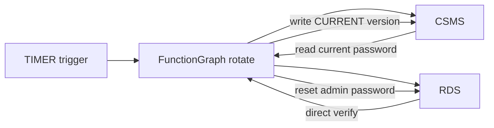

# Scheduled Database Credential Rotation Kit


> Automated rotation of the default administrator password for managed PostgreSQL
> instances, built on Credential Management Service (CSMS / DEW), FunctionGraph
> and Relational Database Service (RDS). Passwords are never written to disk or
> echoed in plaintext.

## 1. Overview

This kit addresses the risk of a database administrator password that never
changes. A timer trigger drives a function that periodically generates a strong
new password, resets the instance password, verifies connectivity with a direct
connection, and stores the new password in the credential management service.

Typical scenarios:

- Administrator passwords must be rotated periodically to meet security policy.
- Passwords should be centrally managed and read by applications through one
  service, instead of being scattered across plaintext configuration files.
- No always-on compute is desired: the function runs only when the trigger fires.

## 2. Key Features

- **Managed storage**: passwords live in the credential management service;
  applications read them through an SDK or API, never from local config files.
- **Zero idle resources**: rotation is driven by a timer trigger, so no compute
  is consumed between runs.
- **Strong password policy**: a built-in generator guarantees upper/lower case
  letters, digits and special characters.
- **Verifiable**: each rotation validates the new password with a direct database
  connection and raises an error on failure, avoiding silent broken credentials.
- **Short-lived credentials**: the function obtains runtime credentials through
  a delegated agency; no long-lived secrets are kept in source code.

## 3. Architecture



A single invocation performs four steps: read the current password, generate a
new one, reset the instance password, then verify and store the new password as
the CURRENT version.

## 4. Cloud Services

| Service | Role |
|---|---|
| Credential Management Service (CSMS / DEW) | Securely stores the credential JSON and its CURRENT version |
| FunctionGraph | Hosts the rotation logic, driven by a timer trigger |
| Relational Database Service (RDS) | Provides the instance whose administrator password is rotated |

## 5. Prerequisites

- A Huawei Cloud account with identity verification completed.
- An RDS instance in the target region (default `cn-north-4`), with its ID,
  address, port and administrator user name at hand.
- A delegated agency (agency) with CSMS and RDS permissions, and its URN.
- Terraform `>= 1.5.0` and Python `>= 3.9` installed locally.
- Access credentials configured for the target region (via environment
  variables or a local profile); never commit long-lived secrets to the repo.

## 6. Quick Start

```bash
# 1. Build the function package (generates src/functions/rotate_secret.zip)
cd src/functions
bash build.sh
cd ../../

# 2. Prepare the variables file
cd infra
cp terraform.tfvars.example terraform.tfvars
# Edit terraform.tfvars: project_id / rds_instance_id / db_host /
# db_initial_password / function_agency

# 3. Initialize and deploy
terraform init
terraform apply
```

After deployment, a credential named `rds-db-credential` exists and both the
function and its timer trigger are ready.

## 7. Deployment

See `docs/deployment-guide.md` for the full step-by-step procedure: building the
package, filling variables, validation and apply. The build script installs
dependencies into a local `pkg/` directory and packages them together with the
function source into the deployment archive referenced by Terraform.

Expected validation output: `Success! The configuration is valid.`

`terraform apply` produces three outputs: `secret_name`, `function_urn` and
`trigger_id`.

## 8. Usage

Rotation runs automatically on the timer trigger (default 02:00 daily). You can
also invoke the function manually from the console for an immediate check.

To verify a rotation:

1. In the CSMS console, open `rds-db-credential` and confirm the `password`
   field of its CURRENT version changed.
2. Connect to the database with that password and run `SELECT 1`.
3. Check the function logs for errors.

## 9. Cleanup

```bash
cd infra
terraform destroy
```

This releases the credential, the function and the trigger.

## 10. License

This repository uses the [MIT-0](LICENSE) license.

## 11. Contact

Maintainer: zhangcheng123321

For support, open a ticket through the official Huawei Cloud support channel or
start a discussion in the repository.

## 12. Creator / Maintainer

| Item | Information |
|---|---|
| **Creator** | zhangcheng123321 |
| **Maintainer** | zhangcheng123321 |
