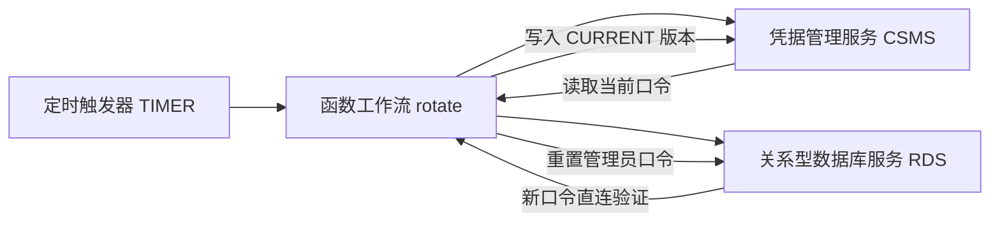

# 数据库凭据定时轮转套件


> 基于凭据管理服务（CSMS / DEW）、函数工作流（FunctionGraph）与关系型数据库服务（RDS）的数据库默认管理员口令自动轮转方案。口令全程不落盘、不回显明文。

## 1. 简介

本套件解决「关系型数据库实例默认管理员口令长期不变」带来的安全风险：通过函数工作流的定时触发器，周期性地生成高强度新口令、重置数据库实例口令、直连验证连通性，并把最新口令安全存入凭据管理服务。

适用场景：

- 数据库实例管理员口令需要周期性轮换以满足安全合规要求；
- 希望口令集中托管、应用侧统一从凭据管理服务读取，避免明文散落；
- 期望零常驻资源——仅在触发器命中时运行函数，平时不产生计算占用。

## 2. 目录

- [1. 简介](#1-简介)
- [3. 架构图](#3-架构图)
- [4. 方案亮点](#4-方案亮点)
- [5. 涉及云服务](#5-涉及云服务)
- [6. 前置条件](#6-前置条件)
- [7. 快速开始](#7-快速开始)
- [8. 分步部署](#8-分步部署)
- [9. 使用方法](#9-使用方法)
- [10. 清理资源](#10-清理资源)
- [11. 详细说明](#11-详细说明)
- [12. 依赖与参考](#12-依赖与参考)
- [13. FAQ](#13-faq)
- [14. 贡献指南](#14-贡献指南)
- [15. 许可证](#15-许可证)
- [16. 联系方式](#16-联系方式)
- [17. 创建者 / 维护者](#17-创建者--维护者)

## 3. 架构图



单次触发在函数中完成四步：读取当前口令 → 生成新口令 → 重置数据库实例口令 → 直连验证并把新口令写入凭据管理服务（标记为 CURRENT 版本）。

## 4. 方案亮点

- **安全托管**：口令统一存于凭据管理服务，应用侧通过 SDK 或接口读取，杜绝明文散落配置文件。
- **零常驻资源**：轮转由定时触发器驱动，函数仅在触发时运行，平时无计算占用。
- **强口令策略**：函数内置口令生成器，保证大小写、数字、特殊字符组合，满足数据库口令复杂度要求。
- **可验证**：每次轮转后用新口令直连数据库执行连通性校验，失败即告警，避免「改密成功但连不上」的静默故障。
- **临时凭据获取**：函数通过委托（agency）模式获取临时凭据，源码不保留任何长期密钥。

## 5. 涉及云服务

本套件使用以下华为云服务：

| 服务 | 角色 |
|---|---|
| 凭据管理服务（CSMS / DEW） | 安全存储数据库口令 JSON，由轮转函数维护其 CURRENT 版本 |
| 函数工作流（FunctionGraph） | 承载轮转逻辑，由定时触发器周期性驱动 |
| 关系型数据库服务（RDS） | 提供数据库实例，轮转其默认管理员口令 |

上述服务按实际用量占用，若不再需要请按[第 10 节](#10-清理资源)执行销毁命令释放资源。

## 6. 前置条件

- 已开通华为云账号并完成实名认证；
- 在目标区域（默认 `cn-north-4`）已创建关系型数据库实例，并记录其 ID、内网/公网地址、监听端口、默认管理员用户名；
- 已创建具备「凭据管理服务」与「关系型数据库服务」权限的委托（agency），并获取其 URN；
- 本地安装 Terraform `>= 1.5.0` 与 Python `>= 3.9`（用于构建函数部署包）；
- 配置好访问目标区域的命令行凭证（通过环境变量或配置文件注入，请勿在仓库中写入长期密钥）。

## 7. 快速开始

```bash
# 1. 构建函数部署包（生成 src/functions/rotate_secret.zip）
cd src/functions
bash build.sh
cd ../../

# 2. 准备变量文件
cd infra
cp terraform.tfvars.example terraform.tfvars
# 编辑 terraform.tfvars，填入 project_id / rds_instance_id / db_host / db_initial_password / function_agency

# 3. 初始化并部署
terraform init
terraform apply
```

部署完成后，凭据管理服务中即出现名为 `rds-db-credential` 的凭据，函数与定时触发器均已就绪。

## 8. 分步部署

### 步骤 1：构建函数包

```bash
cd src/functions
bash build.sh
```

预期输出：

```
==> 安装依赖到 pkg
==> 拷贝函数代码
==> 打包 rotate_secret.zip
==> 构建完成： 13M  rotate_secret.zip
```

### 步骤 2：填写变量

编辑 `infra/terraform.tfvars`，至少配置：

- `project_id`：项目 ID；
- `rds_instance_id`：数据库实例 ID；
- `db_host` / `db_port` / `db_user` / `db_name`：数据库连接信息；
- `db_initial_password`：首次建密用的初始口令（轮转函数首次触发后立即改写）；
- `function_agency`：函数委托 URN。

### 步骤 3：初始化与校验

```bash
terraform init
terraform validate
```

预期输出：`Success! The configuration is valid.`

### 步骤 4：部署

```bash
terraform apply
```

预期输出包含三个输出值：`secret_name`、`function_urn`、`trigger_id`。

## 9. 使用方法

部署完成后，轮转由定时触发器自动驱动（默认每日 `02:00`）。也可在控制台手动触发函数以立即验证。

验证轮转是否成功：

1. 在凭据管理服务控制台查看 `rds-db-credential` 凭据，确认其 CURRENT 版本的 `password` 字段已更新；
2. 用该口令直连数据库执行 `SELECT 1`，返回正常即表示轮转链路畅通；
3. 查看函数运行日志，确认无异常报错。

如需立即验证而不等待定时触发，可在控制台手动触发函数 `db-credential-rotation-rotate`，随后重复上述三步核对。

## 10. 清理资源

如不再需要，请销毁全部资源以免持续占用：

```bash
cd infra
terraform destroy
```

执行后凭据、函数、触发器均被释放。

## 11. 详细说明

### 凭据结构

凭据管理服务中存储的明文为 JSON：

```json
{
  "engine": "postgresql",
  "host": "<数据库地址>",
  "port": 5432,
  "username": "root",
  "dbname": "postgres",
  "password": "<当前口令>",
  "instance_id": "<RDS 实例 ID>"
}
```

### 轮转流程

1. 函数从凭据管理服务读取当前 CURRENT 版本；
2. 生成 32 位高强度口令（保证大小写 + 数字 + 特殊字符）；
3. 调用关系型数据库服务接口重置实例默认管理员口令；
4. 用新口令直连数据库执行 `SELECT 1` 验证；
5. 将新口令作为 CURRENT 版本写回凭据管理服务。

### 凭据获取

函数为委托（agency）模式，运行时会自动注入临时凭据到环境变量（`HUAWEICLOUD_ACCESS_KEY` 等）。代码中仅读取注入的临时凭据，不硬编码任何长期密钥。

### 内网直连

当数据库位于 VPC 内网时，通过 `function_vpc_id` / `function_network_id` / `function_dns_list` 将函数接入对应子网；公网场景留空即可。

## 12. 依赖与参考

函数运行依赖（纯 Python，跨平台可打包）：

- `huaweicloudsdkcore` / `huaweicloudsdkcsms` / `huaweicloudsdkrds`：华为云 SDK；
- `pg8000`：纯 Python 的 PostgreSQL 驱动，用于轮转后的连通性验证。

本函数包依赖开源社区提供的纯 Python 数据库驱动与 SDK 生态，可跨平台构建与部署。

## 13. FAQ

**Q：函数运行报「未检测到运行环境凭据」？**
A：请确认已为函数配置具备 CSMS 与 RDS 权限的委托（agency），且委托 URN 已填入 `function_agency`。

**Q：轮转后应用连不上数据库？**
A：函数内部已做直连验证，若验证失败会显式报错。请检查数据库安全组是否放通函数所在网络，以及 `db_host` / `db_port` 是否填写正确。

**Q：能否轮转非 PostgreSQL 实例？**
A：本套件默认面向 PostgreSQL（口令重置走 RDS 实例级接口，与具体引擎无关）。如为其他引擎，仅需调整凭据 JSON 中的 `engine` 字段与数据库连接验证方式。

**Q：如何调整轮转频率？**
A：修改 `rotation_cron` 变量（Quartz CRON 表达式，六段，末段为年/留 `?`）。

## 14. 贡献指南

欢迎通过提交问题单与合并请求参与改进。提交前请确保：

- 函数代码不引入任何长期密钥硬编码；
- 新增依赖均为纯 Python 包且可跨平台打包；
- 文档中不出现外部平台标识与用量结算描述。

## 15. 许可证

本仓库采用 [MIT No Attribution](LICENSE) 许可证。

## 16. 联系方式

维护团队：zhangcheng123321

如需支持，请通过华为云官方工单渠道提交问题，或在仓库中发起讨论。

## 17. 创建者 / 维护者

| 项 | 信息 |
|---|---|
| **创建者** | zhangcheng123321 |
| **维护者** | zhangcheng123321 |
