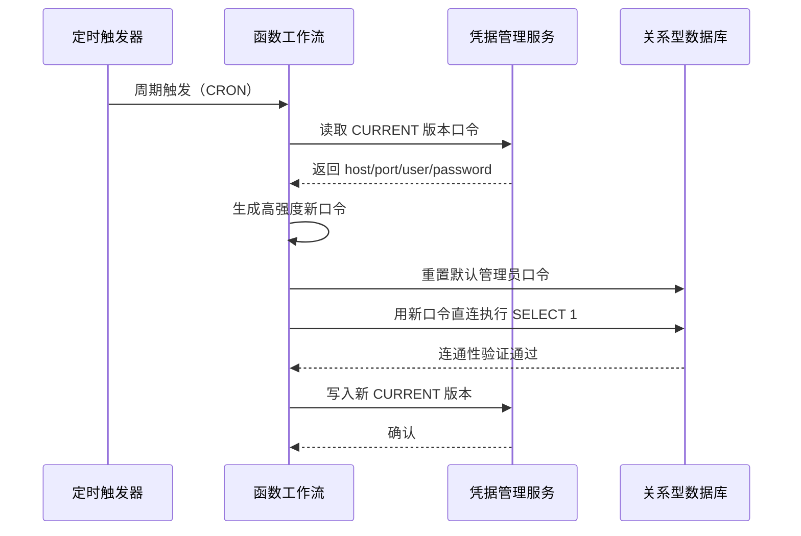

# 架构说明

本文档说明数据库凭据定时轮转套件的整体架构、组件职责与数据流向。

## 1. 组件总览

| 组件 | 服务 | 职责 |
|---|---|---|
| 凭据存储 | 凭据管理服务（CSMS / DEW） | 安全保存数据库口令 JSON，对外暴露读取与版本写入接口 |
| 轮转执行体 | 函数工作流（FunctionGraph） | 承载轮转四步逻辑，由触发器驱动 |
| 调度器 | 函数工作流定时触发器（TIMER） | 按 CRON 周期触发函数 |
| 被管资源 | 关系型数据库服务（RDS） | 提供数据库实例，轮转其默认管理员口令 |

## 2. 数据流向



## 3. 凭据模型

凭据明文以 JSON 存储于凭据管理服务：

```json
{
  "engine": "postgresql",
  "host": "<数据库地址>",
  "port": 5432,
  "username": "root",
  "dbname": "postgres",
  "password": "<当前口令>",
  "instance_id": "<RDS 实例 ID>"
}
```

轮转函数将新口令作为 `CURRENT` 版本写入，旧版本由凭据管理服务按版本阶段管理，应用侧始终读取 `CURRENT`。

## 4. 安全设计

- **临时凭据获取**：函数使用委托（agency）模式，运行环境在运行时提供临时凭据；代码仅读取该凭据，源码不保留任何长期密钥。
- **不回显明文**：初始口令仅用于首次建密，轮转函数首次触发后随即改写，且日志中不输出明文口令。
- **连通性验证**：新口令下发后必须直连数据库验证成功才写回凭据管理服务，避免「改密成功但不可连」的静默故障。
- **最小权限**：委托仅需凭据管理服务读取/写入与关系型数据库口令重置两类权限。

## 5. 网络形态

- **公网/默认网络**：函数使用委托默认网络即可访问凭据管理服务与数据库公网地址，无需额外配置。
- **VPC 内网**：当数据库仅开放内网地址时，通过 `function_vpc_id` / `function_network_id` / `function_dns_list` 将函数接入对应子网，使其能直连数据库。

## 6. 扩展点

- **多引擎**：口令重置走关系型数据库实例级接口，与具体数据库引擎无关；仅需调整凭据 JSON 的 `engine` 字段与直连验证驱动。
- **轮转频率**：通过 `rotation_cron` 变量调整，支持按日/按周/按月等多种周期。
- **原生自动轮转**：若业务允许，也可直接使用凭据管理服务的原生自动轮转能力（指定轮转函数 URN），由服务自身驱动，无需自建定时触发器。
